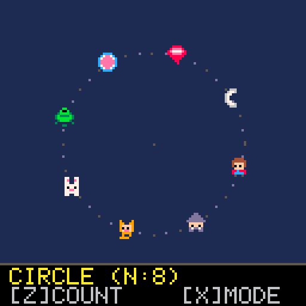
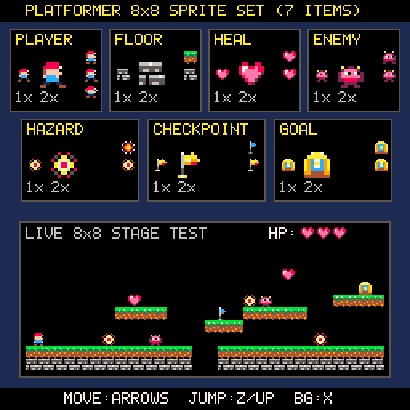

# Usakame Gallery

レトロゲームエンジン **[Usakame](https://github.com/ongaeshi/usakame)** で作成されたゲーム・サンプル作品のギャラリーです。

---

## 作品一覧

### [orbit8.rb](orbit8.rb) — CELESTIAL ORBIT 8



8×8 ピクセルのスプライト（アイテム・人間・動物）がさまざまな軌道を描いて周回するインタラクティブな軌道モーションサンプルです。

#### 起動方法

```bash
uk run orbit8.rb
```

#### 操作方法

| キー | 操作内容 |
| :--- | :--- |
| **`Z` / `Space`** | 周回するオブジェクト数を切り替え（`2` 〜 `256`） |
| **`X` / `Enter`** | 軌道モードを切り替え（`CIRCLE` / `WIDE OVAL` / `TALL OVAL` / `WAVE` / `INFINITY` / `3D GALAXY`） |
| **`↑` / `↓`** | 軌道の半径を拡大・縮小 |
| **`←` / `→`** | 回転速度と回転方向の調整（速度 `0.0` で一時停止スナップあり） |

---

### [platformer8.rb](platformer8.rb) — PLATFORMER 8x8 SPRITE SET & DEMO



8×8 ピクセルのプラットフォーマー（横スクロールアクション）向けスプライト 7 種（プレイヤー・床タイル・回復アイテム・敵・ダメージ物・中間ポイント・ゴール）のカタログビューアと、実際に操作して試遊できるミニステージデモです。

#### 起動方法

```bash
uk run platformer8.rb
```

#### 操作方法

| キー | 操作内容 |
| :--- | :--- |
| **`←` / `→`** | プレイヤーの左右移動 |
| **`Z` / `Space` / `↑`** | ジャンプ（ゴール到達時はステージを即座にリセット） |
| **`X` / `Enter`** | 背景色の切り替え（ダーク / ライト） |

